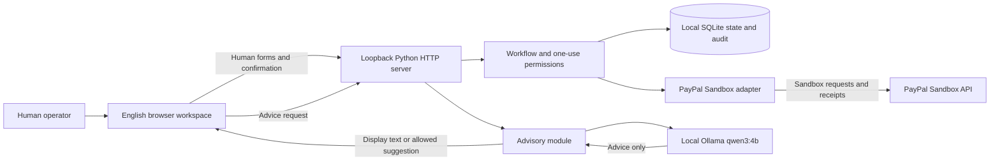

# MilestonePay Agent

A local workspace for freelancers and clients to agree milestone terms and review payment requests with advisory AI. **Private release candidate; real PayPal Sandbox lifecycle checks passed on 2026-10-26.**

## Problem and audience

The project addresses a specific coordination problem: a freelancer and client need to agree what a milestone costs and what counts as delivery before making a payment decision. MilestonePay puts those terms, delivery notes and human approvals in one workspace. This is the intended use case; no user study or measured benefit is claimed.

## What is available locally

- An English, four-step workspace: Agree, Reserve, Deliver, and Release / return, with an advisory panel and audit timeline. Real Sandbox checks covered authorization/capture, authorization/void, and partial then remaining-balance refunds.
- Human-entered milestone titles, amounts, EUR/USD currency and acceptance criteria, with server validation of amounts and totals. Each saved plan has a version.
- Optional AI questions about missing or conflicting terms, plain-language payment explanations, and a criterion-by-criterion comparison of delivery **notes**: Met, Uncertain, or Not met. A valid next-action suggestion highlights an allowed action for the human to choose.
- Server-owned payment proposals: the browser supplies an action and milestone reference; the server derives the version, amount and currency from saved terms. Sending a request requires explicit human confirmation and a short-lived, one-use permission bound to those terms.
- A persisted local audit timeline with UTC event ordering and redacted receipt fields. AI failure is labelled **AI unavailable**, with static guidance and human forms remaining available.

## Architecture



AI has no route to issue permissions or execute payments. Runtime payment requests target `api-m.sandbox.paypal.com`; there is no production switch.

## Install and run

Requirements: Python 3.10+ and a desktop browser. Application runtime and Python tests use the standard library; there are no pip dependencies. From this repository:

```sh
python3 -m unittest discover -v
python3 app.py
```

Open `http://127.0.0.1:8765/`. To choose another port: `python3 app.py 8766`.
Run one app process per workspace. Keep `.local/workflow.sqlite3` private and preserve it after an interrupted request for reconciliation. Ctrl-C stops the app.

### Optional local AI: Ollama and qwen3:4b

Install [Ollama](https://ollama.com/download) separately. The app expects the local server on **11435**, rather than Ollama's default 11434. For a new dedicated CLI instance, use these commands in separate terminals; if one already serves 11435, use it:

```sh
# Terminal A: keep running while using AI
OLLAMA_HOST=127.0.0.1:11435 ollama serve
```

```sh
# Terminal B: only needed if qwen3:4b is not already installed
OLLAMA_HOST=127.0.0.1:11435 ollama pull qwen3:4b
OLLAMA_HOST=127.0.0.1:11435 ollama list
```

The download command is an operator setup step; the app does not download models, manage the Ollama service, or call a paid AI endpoint. Prompts use qwen3:4b with temperature 0, seed 42, 8192 context and a 1024-token output cap. Local inference may fail or be slow; the fallback works without a model. Setup references: [Ollama host configuration](https://docs.ollama.com/faq), [qwen3:4b](https://ollama.com/library/qwen3:4b).

### Sandbox accounts and local credentials

Use a PayPal Developer **Sandbox business account/app** for merchant API credentials and a separate **Sandbox personal account** for buyer checkout. The operator obtains or creates these in the [Developer Dashboard](https://developer.paypal.com/dashboard/accounts); see [Sandbox account instructions](https://developer.paypal.com/sandbox-testing/accounts). No shared test login or credentials are included in this repository.

Create `.env.local` locally with the following keys, replacing the placeholders with your own Sandbox app credentials:

```dotenv
PAYPAL_CLIENT_ID=your_sandbox_client_id
PAYPAL_CLIENT_SECRET=your_sandbox_client_secret
```

Restart the app after configuration. Do not put buyer passwords in this file, commit credentials, or use production credentials. Without both values the status says credentials are missing. Present values are labelled **check individual operation receipts**; their presence does not establish API access. An injected fake service is labelled **Fake payment service · no Sandbox connection**.

**Real Sandbox checks passed on 2026-10-26:** EUR8 authorization/capture; EUR2 authorization/void; and EUR4 capture followed by EUR1 partial and EUR3 remaining-balance refunds. Independent GET requests confirmed the capture, void and refund states. These were virtual Sandbox transactions, not live payments. Judge access arrangements and any private test access remain for the author to finalize before submission; do not publish secrets in the repository.

## AI use and limitations

Runtime AI is local Ollama/qwen3:4b. It provides advisory text, structured delivery-note comparisons and optional suggestions from the current allowed action set. Its output can be wrong; the human must verify terms and inspect the actual deliverables. No AI extraction accuracy or user-effect metric is presented.

Codex assisted with code, tests, interface, prompts and documentation. Claude supplied project strategy and scope decisions. The author remains responsible for reviewing the work and confirming rights before release. Model weights are not distributed; see [THIRD_PARTY_NOTICES.md](THIRD_PARTY_NOTICES.md).

## Known limitations

- Single-user, loopback-only prototype. No shared remote accounts, hosted collaboration, identity verification, escrow service or dispute resolution.
- A typed name and checkbox represent local confirmation, not a legal electronic-signature service. Permissions expire after 120 seconds. Edits before checkout invalidate previous proposals; terms lock after checkout begins.
- Interrupted requests require rechecking status before a newly signed retry. Saved request identities are reused for uncertain retries; automatic resend stops after five hours for manual reconciliation. This behavior has local fake-service test coverage only.
- AI compares text notes, not uploaded files. Semantic quality and real-user outcomes have not been established. Local tests use deterministic fake responses and do not establish real Sandbox payment acceptance.
- The audit is a local SQLite record, not tamper-proof storage. Desktop use has been inspected locally; mobile devices have not been tested.

## License — draft, pending author confirmation

[LICENSE](LICENSE) contains a proposed MIT license for author review. **Zhao Liu has not yet confirmed this license or authorized publication.** This local candidate is a review package; the MIT draft is not a statement that a public release has occurred. Third-party tools and model weights retain their own licenses.
